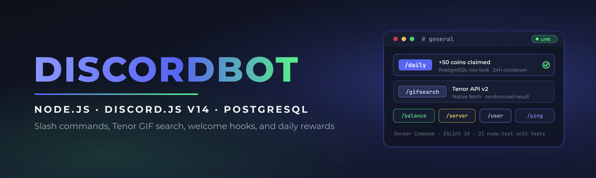
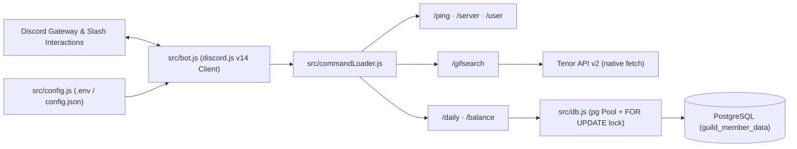

A Discord server bot built with Node.js, [discord.js](https://discord.js.org/) v14, and PostgreSQL. It handles slash commands, Tenor v2 GIF lookups, member welcome/leave announcements, and a transactional daily coin reward system that runs locally or with Docker Compose.

## Status

**Complete (archived class project, refreshed for public reference).**

Originally built in 2023 by Gabriel Parra, Maria Hernandez, and Jhon Tabio, then cleaned up and updated for Node.js 20+, discord.js v14, PostgreSQL 16, ESLint, unit tests, and GitHub Actions CI. It isn't hosted as a public bot instance; clone the repo and run it with your own Discord application token and PostgreSQL database.

## Features & Commands

| Command | Scope | Description |
| --- | --- | --- |
| `/ping` | Anywhere | Replies with `Pong!` and current Discord WebSocket latency. |
| `/server` | Server | Shows the server name, member count, and creation date. |
| `/user [target]` | Server | Shows a member's username and server join date (defaults to you). |
| `/gifsearch <query>` | Anywhere | Queries Tenor API v2 via native `fetch` and posts a random matching GIF. |
| `/daily` | Server | Claims a daily coin reward using a PostgreSQL row lock and configurable cooldown (24 hours by default). |
| `/balance [target]` | Server | Shows your coin balance or another server member's balance. |

### Event Hooks

- **Mention ping:** Mentioning the bot with `ping` in a channel replies with `Pong!` (ignores bots, replies, and `@everyone`/`@here`).
- **Member join:** Sends a welcome DM (skipping cleanly if the user's DMs are closed) and posts a greeting in `WELCOME_CHANNEL_NAME` (defaults to `#general`, or falls back to the first text channel where `@everyone` can send messages).
- **Member leave:** Announces departures in the same announcement channel.

## Architecture



## Prerequisites

- **Node.js 20+** (or **Docker** with Compose v2)
- A Discord application and bot token from the [Discord Developer Portal](https://discord.com/developers/applications)
  - Enable **Server Members Intent** and **Message Content Intent** under **Bot** settings for join/leave announcements and mention responses.
- **PostgreSQL 14+** (bundled in `docker-compose.yml`) for `/daily` and `/balance`
- A [Tenor API v2 key](https://developers.google.com/tenor) if you want `/gifsearch` enabled

## Quick Start

### Option 1: Docker Compose (recommended)

`docker-compose.yml` starts PostgreSQL 16 (automatically applying `database/init.sql` on first boot) along with the bot container:

```bash
cp .env.example .env
# Edit .env with your Discord token, client ID, Postgres password, and optional Tenor key
docker compose up --build -d
```

Register the slash commands with Discord:

```bash
docker compose run --rm discord npm run deploy-commands
```

### Option 2: Run Locally

1. Copy `.env.example` to `.env` and fill in your local values:

   ```bash
   cp .env.example .env
   ```

2. Install dependencies:

   ```bash
   npm install
   ```

3. Initialize the PostgreSQL schema:

   ```bash
   psql "$DATABASE_URL" -f database/init.sql
   ```

4. Register slash commands with Discord:

   ```bash
   npm run deploy-commands
   ```

5. Start the bot:

   ```bash
   npm start
   ```

## Configuration

All settings load from `.env` (or environment variables), with optional fallback to a local `config.json` for Discord credentials.

| Variable | Required | Default | Description |
| --- | --- | --- | --- |
| `DISCORD_TOKEN` | Yes | | Discord bot token. |
| `DISCORD_CLIENT_ID` | For deploy | | Discord application client ID (used by `deploy-commands.js`). |
| `DISCORD_GUILD_ID` | No | | Optional server ID for instant guild-scoped slash command deployment. Leave empty for global registration. |
| `TENOR_API_KEY` | For `/gifsearch` | | Tenor API v2 key. |
| `POSTGRES_USER` | For DB | `postgres` | PostgreSQL username. |
| `POSTGRES_PASSWORD` | For DB | | PostgreSQL password. |
| `POSTGRES_DB` | For DB | `discordbot` | PostgreSQL database name. |
| `PGHOST` | No | `localhost` | PostgreSQL host (set automatically to `postgres` in Docker Compose). |
| `PGPORT` | No | `5432` | PostgreSQL port. |
| `DATABASE_URL` | No | | Optional PostgreSQL connection URI (overrides individual `PG*` variables). |
| `WELCOME_CHANNEL_NAME` | No | `general` | Preferred text channel name for member join/leave announcements. |
| `CURRENCY_NAME` | No | `coins` | Display name for the bot's virtual currency. |
| `DAILY_REWARD` | No | `50` | Amount granted by `/daily`. |
| `DAILY_COOLDOWN_HOURS` | No | `24` | Hours required between `/daily` claims. |

## Development & Testing

No live Discord token or PostgreSQL instance is needed to run linting or unit tests:

```bash
npm run lint   # Run ESLint 10 across the codebase
npm test       # Run 21 unit tests using Node's built-in node:test runner
```

GitHub Actions (`.github/workflows/ci.yml`) runs both checks on Node 20 and Node 22 for every push to `main` and every pull request.

## Project Structure

```text
assets/               README hero banner source (SVG) and rendered PNG
commands/fun/         Slash command modules (ping, server, user, gifsearch, daily, balance)
database/init.sql     PostgreSQL schema for guild_member_data balances and cooldowns
src/bot.js            Discord client factory and event handlers
src/commandLoader.js  Dynamic slash command discovery and validation
src/config.js         Environment configuration loader and validation
src/db.js             Shared PostgreSQL pool and transactional reward/balance queries
deploy-commands.js    Slash command registration CLI
index.js              Application entrypoint and graceful SIGINT/SIGTERM shutdown
tests/                Unit tests using node:test
```

## License

[MIT](LICENSE)
